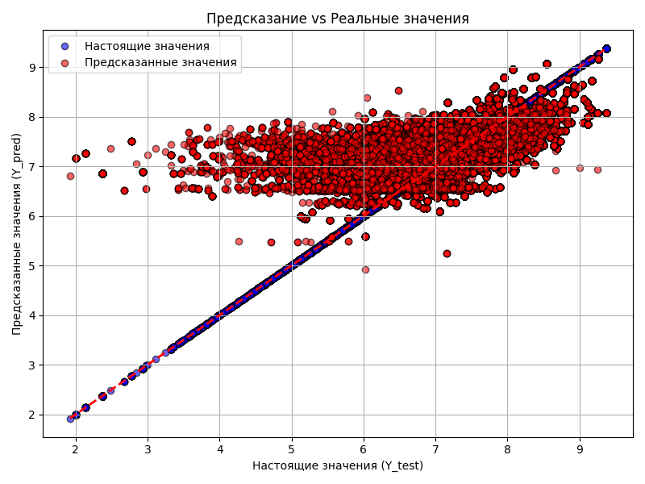

# dvc — Anime Rating Regression Experiments

**A comparison of regression models for anime rating prediction, with Optuna tuning, feature analysis and an experimental DVC pipeline.**

English | [Русский](README.ru.md)

This research/coursework repository explores supervised regression on an anime ratings dataset. It combines feature preparation, several model families, hyperparameter optimization, diagnostic plots and data/model versioning experiments with DVC.



## What's inside

- **Regression baselines:** linear/ridge regression and decision-tree regression.
- **Ensemble models:** CatBoost and XGBoost regressors.
- **Neural-network baseline:** scikit-learn `MLPRegressor`.
- **Hyperparameter search** with Optuna; metrics include MAE, MSE, RMSE and R².
- **Interpretation and comparison:** feature importance, fitted-vs-actual plots and weight/parameter visualizations.
- **DVC experiment files:** `dvc.yaml`, `dvc.lock` and a tracked CSV declaration.

This is a **rating regression** study, not a complete user-facing recommendation service.

## Requirements

Python 3.10+ recommended, with `numpy`, `pandas`, `scikit-learn`, `matplotlib`, `seaborn`, `optuna`, `catboost`, `xgboost`, `joblib`, and optionally `dvc` / Jupyter for the notebook workflow.

```bash
python -m venv .venv
source .venv/bin/activate
python -m pip install numpy pandas scikit-learn matplotlib seaborn optuna catboost xgboost joblib dvc jupyter
```

## Data setup — read before running

**This snapshot is not fully reproducible out of the box.** It contains `anime.csv`, several processed `Y_*.csv` files, notebooks, fitted models and plots, but some scripts require CSV files **not present** in the supplied archive:

- `df_final_for_lr.csv` — referenced by `linear_regression.py`, `neural_network.py` and `final_comparison.py`.
- `df_final_for_lr_cleaned.csv` — referenced by `catboost_learning.py`; a `.dvc` tracking file exists but the data itself is not included.
- `df.csv` — referenced in `dvc.yaml`, which does **not** match the CatBoost script's hard-coded data path.
- `rating.csv` — referenced by `ML.py` during the original preprocessing experiment.

Restore or recreate these inputs before training. The current `dvc.yaml` command and file dependencies also need to be reconciled before `dvc repro` can succeed. Do not interpret the example commands below as guaranteed executable against the snapshot alone.

## Example workflow

Once `df_final_for_lr_cleaned.csv` is available in the project root:

```bash
python catboost_learning.py
```

When the corresponding `df_final_for_lr.csv` and required model artifacts are available:

```bash
python linear_regression.py
python neural_network.py
python final_comparison.py
```

`final_comparison.py` loads **five pretrained model files**, including `decision_tree_optuna.pkl`, which is absent from this snapshot. Generate or restore missing files before using it. Several training scripts produce interactive Matplotlib figures and save model `.pkl` artifacts locally.

## Results and interpretation

| Artifact | What it shows |
|---|---|
| [`plot_y_vs_y_pred_comparison.png`](plot_y_vs_y_pred_comparison.png) | Predicted vs. actual ratings for comparison |
| [`plot_feature_weights.png`](plot_feature_weights.png) | Feature contribution visualization |
| [`xgboost_feature_importance.png`](xgboost_feature_importance.png) | XGBoost feature importance |
| [`linear_regression_results.txt`](linear_regression_results.txt) | Stored linear-regression results |

Graphs are saved outputs from the archived experiments. Recalculate metrics on a known split before using them as validated performance claims.

## Repository layout

```text
ML.py, *.ipynb                preprocessing and exploratory notebooks
linear_regression.py          Ridge + Optuna
catboost_learning.py          CatBoost + Optuna
xgboost_learning.py           XGBoost + Optuna
neural_network.py             MLP regression + Optuna
tree.py                       decision-tree regression
final_comparison.py           model metrics and visualizations
*.png, *.pkl                  experiment plots and model artifacts
dvc.yaml, dvc.lock, .dvc/     experimental DVC configuration
```

## Limitations

- Different scripts use different train/test splits and some evaluate on training data; numbers are **not automatically comparable**.
- The DVC metadata and available file names are inconsistent, as noted above.
- The supplied archive does not include a top-level licence file.
