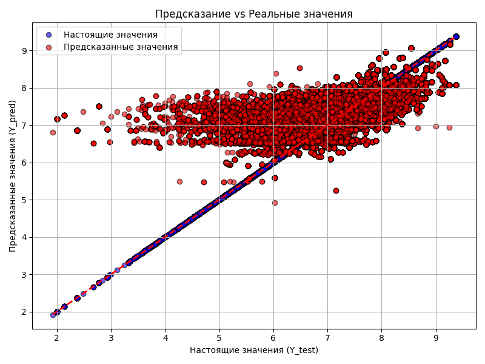

# dvc — эксперименты по регрессии рейтингов аниме

**Сравнение регрессионных моделей для оценки рейтингов аниме: Optuna, анализ признаков и экспериментальный DVC-конвейер.**

[English](README.md) | Русский

Учебно-исследовательский проект по регрессии на данных о рейтингах аниме. В репозитории собраны эксперименты с подготовкой признаков, разными семействами моделей, поиском гиперпараметров, диагностическими графиками и управлением данными через DVC.



## Возможности

- **Базовые регрессионные модели:** линейная / Ridge-регрессия, дерево решений.
- **Ансамбли:** CatBoost и XGBoost.
- **Нейросетевой подход:** `MLPRegressor` из scikit-learn.
- **Подбор гиперпараметров:** Optuna; метрики MAE, MSE, RMSE и R².
- **Сравнение и интерпретация:** важности признаков, графики истинных и предсказанных значений, визуализация параметров моделей.
- **Эксперимент с DVC:** `dvc.yaml`, `dvc.lock`, описание отслеживаемого набора данных.

Это исследование **регрессии рейтинга**, а не готовый рекомендательный сервис.

## Требования

Рекомендуется Python 3.10+ и библиотеки `numpy`, `pandas`, `scikit-learn`, `matplotlib`, `seaborn`, `optuna`, `catboost`, `xgboost`, `joblib`. Для дополнительных сценариев пригодятся `dvc` и Jupyter.

```bash
python -m venv .venv
source .venv/bin/activate
python -m pip install numpy pandas scikit-learn matplotlib seaborn optuna catboost xgboost joblib dvc jupyter
```

## Подготовка данных

**Переданный архив не является полностью воспроизводимой сборкой.** В нём есть `anime.csv`, несколько обработанных `Y_*.csv`, ноутбуки, веса моделей и графики, но отсутствуют исходные CSV, требуемые частью скриптов:

- `df_final_for_lr.csv` — необходим для `linear_regression.py`, `neural_network.py`, `final_comparison.py`.
- `df_final_for_lr_cleaned.csv` — необходим для `catboost_learning.py`; его отслеживает `.dvc`-файл, но самого CSV нет.
- `df.csv` — указан в `dvc.yaml`, хотя CatBoost-скрипт жёстко ожидает другой файл.
- `rating.csv` — используется на этапе подготовки в `ML.py`.

Перед повторным обучением восстановите исходные данные. Команды и зависимости в `dvc.yaml` также нужно согласовать с содержимым скриптов, иначе `dvc repro` не будет корректно воспроизводить эксперимент.

## Примеры запуска

Если в корне есть `df_final_for_lr_cleaned.csv`:

```bash
python catboost_learning.py
```

Если восстановлены `df_final_for_lr.csv` и нужные сохранённые модели:

```bash
python linear_regression.py
python neural_network.py
python final_comparison.py
```

`final_comparison.py` загружает **пять файлов моделей**, в том числе отсутствующий в архиве `decision_tree_optuna.pkl`. Для полноценного сравнения его тоже нужно восстановить или обучить. Часть скриптов показывает графики Matplotlib и сохраняет модели `.pkl`.

## Графики и результаты

| Артефакт | Содержание |
|---|---|
| [`plot_y_vs_y_pred_comparison.png`](plot_y_vs_y_pred_comparison.png) | Сравнение прогнозируемого и истинного рейтинга |
| [`plot_feature_weights.png`](plot_feature_weights.png) | Визуализация вкладов признаков |
| [`xgboost_feature_importance.png`](xgboost_feature_importance.png) | Важности признаков XGBoost |
| [`linear_regression_results.txt`](linear_regression_results.txt) | Сохранённые результаты линейной регрессии |

Это артефакты прежних прогонов. Перед использованием чисел как подтверждённых метрик нужно пересчитать их на едином корректно выделенном тестовом наборе.

## Структура репозитория

```text
ML.py, *.ipynb                подготовка признаков и исследование данных
linear_regression.py          Ridge и Optuna
catboost_learning.py          CatBoost и Optuna
xgboost_learning.py           XGBoost и Optuna
neural_network.py             нейросетевая регрессия и Optuna
tree.py                       регрессия деревом решений
final_comparison.py           сравнение метрик и графики
*.png, *.pkl                  результаты экспериментов и модели
dvc.yaml, dvc.lock, .dvc/     экспериментальная конфигурация DVC
```

## Ограничения

- Скрипты используют разные разбиения данных; некоторые оценивают качество на обучающей выборке. Метрики **нельзя напрямую сравнивать** без единого протокола.
- Метаданные DVC и названия входных файлов расходятся (подробности выше).
- В переданном архиве нет файла с лицензией проекта.
